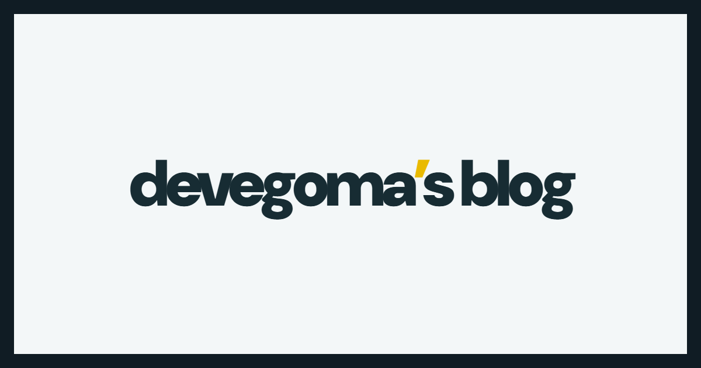

# Issue #30 T2 共通共有画像

## 成果物

- 公開ファイル：`public/images/social-share.png`
- 公開パス：`/images/social-share.png`
- 本番想定URL：`https://blog.devegoma.com/images/social-share.png`
- 形式・寸法：不透明PNG、1200×630px、23,846 bytes
- SHA-256：`6EAC131E10E367306C0208BD1978A4BEF6A2E0391FF395EA565E2363F0E624B9`
- 制作元：`output/issue-30/render-social-share.mjs`
- 専用検証：`unit-tests/social-share-image.test.mjs`。既存の `pnpm test:unit` の対象に含まれる。



明るい背景 `#f3f7f8`、濃いサイト名 `#172c33`、黄色いアポストロフィ `#e9ba00`。既存と同じ「devegoma’s blog」を中央に配置した。記事名・日付・追加の紹介文は入れていない。1200×630pxは今回の共通画像の制作寸法であり、各サービスの実表示保証を意味しない。

追加依頼により、外周にサイトのダークテーマ背景色 `#101c24` の24px枠を付けた。再出力後に専用テスト1件が成功し、枠が四辺に表示され、明るい背景と中央のロゴが保たれていることを実画像で確認した。ファイルサイズとハッシュは枠追加後の値。

## 素材・利用条件と再制作

`src/components/SiteHeader.astro` と `src/styles/home.css` の既存文字ロゴを再現した。DM Sans、font-weight 1000、letter-spacing -0.075em、line-height 1.12を継承し、画像用の文字サイズは112px。旧案の画像を拡大・切り抜きせず、HTML/CSSから描画した。新規の画像生成・外部素材・依存追加はない。

フォントは既存の `public/fonts/dm-sans.ttf` を加工せず使用。出典は `public/fonts/README.md`、ライセンス全文は `public/fonts/OFL-DM-Sans.txt`。Copyright 2014 The DM Sans Project Authors、SIL Open Font License 1.1。同梱のライセンスは、フォントを用いて作成した文書にはフォント自体のライセンス維持要件を適用しないと記載している。ロゴ実装・配色の出典は本リポジトリ（ルート `LICENSE` はMIT）。ライセンスファイルは変更していない。

既存のPlaywrightとChromiumを利用し、サイトのビルドやサーバーなしで再制作できる。

```powershell
node output/issue-30/render-social-share.mjs
node --test unit-tests/social-share-image.test.mjs
```

このCodex制限環境では既定のブラウザ保存先が別パスになるため、今回のプロセスに限って次を設定して制作・テストを実行した。端末固有のパスはソースへ埋め込んでいない。

```powershell
$env:PLAYWRIGHT_BROWSERS_PATH = 'C:\Users\ihash\AppData\Local\ms-playwright'
```

## TDD・確認結果

承認された公開画像の読み込み・形式・寸法を一つの振る舞いとして検証した。内部の制作手順やCSSをテストの契約にはしていない。

1. Red：画像制作前に `node --test unit-tests/social-share-image.test.mjs` を実行。`public/images/social-share.png` が存在せずENOENTで1件失敗した。
2. Green：制作スクリプトでPNGを書き出し、同じ専用テストが1件成功した。PNGシグネチャと、Chromiumの実デコーダでの読込・1200×630pxを確認した。
3. 専用2ファイルへのESLintは成功。Prettierでテストファイルの整形を修正し、最終確認でも成功した。
4. 書き出したPNGを画像ビューアで視覚確認。明るい背景、濃い中央の一行ロゴ、黄色いアポストロフィ、十分な周囲の余白、文字の欠けがないこと、記事名・日付がないことを確認した。機械的な寸法検証を見た目の確認の代用にはしていない。

制作時の最初の実行は既定ブラウザパスの不一致で失敗。承認された通常環境での実行は既存 `@playwright/test` が見つからず失敗した。既存ブラウザの保存先をプロセス環境変数で指定した後、制限環境の導入済み依存で制作・検証が成功した。依存の取得・再導入は行っていない。

## T1・T3への引き継ぎ

画像参照は `/images/social-share.png` に統一し、共有情報には本番ドメインの絶対URLを利用できる。画像の説明案は「明るい背景に、濃い色のdevegoma’s blogと黄色いアポストロフィのロゴ」。寸法はwidth 1200、height 630、MIMEは `image/png`。

T2はhead・各ページ・T1/T3のテスト・`docs/work-plan.md` を変更していない。専用チェックはサイトのビルドや一時記事を使わず、他タスクの検証と競合しない。CIは `pnpm test` の前にPlaywrightブラウザを導入する既存順序であることを確認した。

生成HTMLからの参照、プレビューHTTPでのContent-Type・取得、本番HTTP、Xの実際のカード表示はT3で確認する。本番URLは想定であり、T2では本番配信を確認していない。デプロイ・公開投稿・push・PR作成は行っていない。
